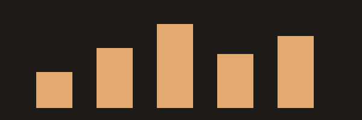

+++
title = 'Markdown Showcase'
date = 2026-09-22T14:30:00
image = 'cover.svg'
imageAlt = 'Blue gradient with wave lines'
+++

This post exercises the Markdown features the blog supports, so you can see how each one renders.

## Text formatting

Plain text with **bold**, *italic*, ***bold italic***, ~~strikethrough~~, and `inline code`.
Smart typography turns "straight quotes" into curly ones, -- into an en dash, --- into an em dash, and ... into an ellipsis.

Here is a line with a hard break at the end\
and the next line continues here.

## Headings

### Third-level heading

#### Fourth-level heading

##### Fifth-level heading

## Links

- An inline link to [Hugo](https://gohugo.io)
- A link with a title: [Goldmark](https://github.com/yuin/goldmark "The Markdown parser Hugo uses")
- A reference-style link to [KaTeX][katex]
- A bare URL: <https://example.org>
- A link to a heading on this page: [jump to Math](#math)

[katex]: https://katex.org

## Lists

Unordered, with nesting:

- Apples
- Citrus
  - Oranges
  - Lemons
    - Meyer lemons
- Pears

Ordered, starting at 3:

3. Preheat the oven
4. Mix the dough
5. Bake for 20 minutes

Task list:

- [x] Install Sass
- [x] Add the Rasa font
- [ ] Write a real post

## Blockquotes

> The best way to predict the future is to invent it.
>
> > A nested quote sits inside the first one.
>
> — Alan Kay

## Code

A fenced block with syntax highlighting:

```python
def fib(n: int) -> int:
    """Return the nth Fibonacci number."""
    a, b = 0, 1
    for _ in range(n):
        a, b = b, a + b
    return a
```

With line numbers and highlighted lines:

```go {linenos=true, hl_lines=[3]}
package main

import "fmt"

func main() {
	fmt.Println("hello, world")
}
```

A plain block with no language:

```
no highlighting here
```

## Tables

| Feature        | Syntax              | Aligned right |
| :------------- | :-----------------: | ------------: |
| Bold           | `**text**`          |             1 |
| Italic         | `*text*`            |            22 |
| Strikethrough  | `~~text~~`          |           333 |

## Images

A figure from the post's own folder:



## Footnotes

Footnotes are collected at the bottom of the post.[^1] You can use names instead of numbers.[^named]

[^1]: This is the first footnote.
[^named]: This one is labelled `named` in the source.

## Definition lists

Markdown
: A lightweight markup language.

LaTeX
: A typesetting system for math and scientific writing.
: It also has a second definition.

## Math

Inline math like $a^2 + b^2 = c^2$ or \(\frac{1}{2}\) sits in the sentence.

Display math gets its own line:

$$
\sum_{k=1}^{n} k = \frac{n(n+1)}{2}
$$

A matrix:

\[
A = \begin{pmatrix} 1 & 2 \\ 3 & 4 \end{pmatrix}, \qquad \det A = -2
\]

Aligned equations:

$$
\begin{aligned}
(x + y)^2 &= x^2 + 2xy + y^2 \\
(x - y)^2 &= x^2 - 2xy + y^2
\end{aligned}
$$

A literal dollar sign needs escaping: this costs \$5.

## Raw HTML

<details>
<summary>Click to expand</summary>

Hidden content, revealed on click. Press <kbd>Ctrl</kbd> + <kbd>C</kbd> to copy.

</details>

## Horizontal rule

---

That's the end of the showcase.
